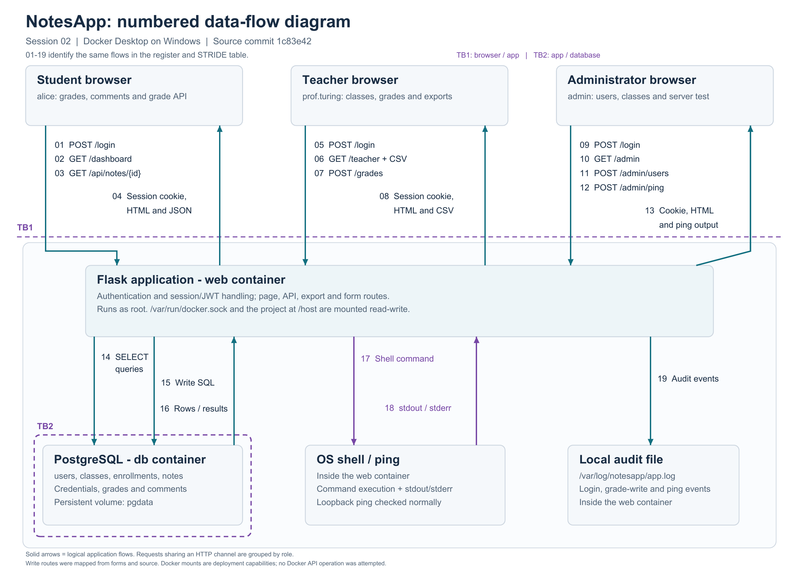

# NotesApp — Security Coursework

**Full name:** 陈子明 Chen Ziming

**CHU Student ID:** 2023905333

| Coursework | Implementation and evidence |
| --- | --- |
| Project 1: threat model | [Group report, data-flow diagram and STRIDE analysis](project1/README.md) |
| Session 02: application observation | Historical observations, numbered flows and initial STRIDE analysis below |
| Session 03: symmetric encryption lab | [Caesar frequency analysis and AES-ECB/GCM image comparison](docs/session03/lab/README.md) |
| Session 03 homework: encrypted comments | [AES-256-GCM storage, migration and verification](docs/session03/homework/README.md) |
| Session 04 homework: export integrity | [HMAC-SHA-256 CSV export and upload verification](docs/session04/README.md) |

The active application includes comment encryption and authenticated CSV exports. Follow the [Session 04 setup instructions](docs/session04/README.md#run-and-demonstrate) to initialize both independent keys before starting Docker Compose. The Windows launcher initializes them automatically. Run the regression suite from the repository root after installing `requirements-dev.txt`, with the local lab PostgreSQL service available on port 15432:

```powershell
python -m pytest -q --cov=export_hmac --cov=comment_crypto --cov=comment_migration --cov-branch --cov-report=term-missing --cov-fail-under=95
```

Verified 22 October 2026: 75 application tests and 52 standalone lab tests passed. The comment encryption, migration and export HMAC modules each have 100% statement and branch coverage. Integration tests use disposable databases and do not modify the running application's database. See the [verification record](docs/coursework-verification-20261022.json).

## Session 02 Threat Model

The following report records the Session 02 application before comment encryption. Its observations and unsigned CSV samples are historical. The original source and report are preserved in the local course archive at `Assignments/Session02/pre-homework`.

陈子明 Chen Ziming · CHU Student ID 2023905333 · Individual submission · 8 October 2026

## Environment

NotesApp is a grades application with student, teacher and administrator accounts. This report contains the numbered data-flow diagram and STRIDE table required for Session 02. The application was built with Docker Desktop on Windows from commit `1c83e42`, which matched the fork and course upstream when checked.

| Component | Checked environment |
| --- | --- |
| Docker Desktop | 4.94.0 |
| Docker Engine / Compose | 29.8.2 / 5.5.1 |
| Web service | Python 3.11.17, Flask 3.0.3 |
| Database | PostgreSQL 15.19 (Debian 15.19-1.pgdg13+2) |
| Seeded data | 35 users, 4 classes, 60 grades |
| Local web address | <http://localhost:8080> |

`compose.windows.yml` binds the application to `127.0.0.1:8080` and PostgreSQL to `127.0.0.1:15432`. Port 5432 is already used by the Windows PostgreSQL service. The application code, container permissions and mounts use the course configuration.

## Roles and assets

| Role | Intended access | Pages and controls examined |
| --- | --- | --- |
| Student | Read own grades and teacher comments. | Login, dashboard, own-grade API and logout. |
| Teacher | Read and enter grades for assigned classes; export those records. | Login, class list, grade table, add/update form, CSV links and logout. |
| Administrator | Manage user accounts and review classes. | Login, user/class lists, create/delete forms, server-test form and logout. |

The main assets are grades, teacher comments, account credentials, roles and sessions. Grades must remain accurate and private, and the system needs reliable logs and continued availability. The administrator can view classes in this version, but there is no class-edit route. The Docker socket mount is also relevant: an application compromise could affect resources beyond the web container.

## Local observations

| Check | Result |
| --- | --- |
| Application health | `/healthz` returned HTTP 200 and `ok`. |
| Student login and dashboard | `alice` reached `/dashboard`; two grades were displayed. |
| Student API | Loading own note `2` returned HTTP 200: alice, Computer Science, 10.5. |
| Teacher view | `prof.turing` reached `/teacher`; four classes and 60 grade rows were visible. The add/update form was present. |
| Teacher exports | Four fresh CSV files were downloaded using each class's assigned teacher account. |
| Admin console | `/admin` displayed 35 users, four classes, account forms and the server test. |
| Normal server test | The admin form was checked with `127.0.0.1`; the result reported 0% packet loss. |
| Logout | Each observed role returned to `/login`. |
| Record integrity | Before/after hashes of users, classes, notes and enrollments matched. |

Although prof.turing is assigned Mathematics, the teacher page lists all four classes. The query in `teacher()` has no teacher ownership filter. Grade and account forms were examined without submitting changes. Screenshots: [student](docs/session02/evidence/student.png), [teacher](docs/session02/evidence/teacher.png), [admin](docs/session02/evidence/admin.png), [admin tools](docs/session02/evidence/admin-tools.png).

## Numbered data-flow diagram



[Vector diagram](Session02_Data_Flow.svg)

**TB1 — browser/application:** requests carry user input, cookies and tokens; responses carry cookies, HTML, JSON and CSV.

**TB2 — application/database:** the web service connects using database credentials, sends SQL and receives rows or operation results.

The shell and audit file are inside the web container and share its OS identity. The Docker socket and project directory are mounted read-write; no application route calls the Docker API. Requests sharing one HTTP channel are grouped in the diagram, with a separate numbered entry for each logical flow. Logout, redirects and CSS use the same browser/application boundary.

| Flow | Purpose | Sender → receiver | Data crossing | Boundary | Evidence |
| --- | --- | --- | --- | --- | --- |
| 01 | Student login | Student browser → Flask | POST /login: username and password. | TB1 | Observed |
| 02 | Student dashboard | Student browser → Flask | GET /dashboard: session cookie. | TB1 | Observed |
| 03 | Grade API | Student browser → Flask | GET /api/notes/{id}: note ID and Bearer JWT. | TB1 | Own record observed |
| 04 | Student responses | Flask → Student browser | Session cookie, grade-page HTML and grade JSON. | TB1 | Observed |
| 05 | Teacher login | Teacher browser → Flask | POST /login: username and password. | TB1 | Observed |
| 06 | Teacher reads | Teacher browser → Flask | GET /teacher and /export.csv?class_id={id}: session and class ID. | TB1 | Page and exports observed |
| 07 | Grade changes | Teacher browser → Flask | POST /grades: note_id, student_id, class_id, grade and comment. | TB1 | Form/source inspected |
| 08 | Teacher responses | Flask → Teacher browser | Session cookie, classes/grade HTML and downloaded CSV. | TB1 | Observed |
| 09 | Admin login | Admin browser → Flask | POST /login: username and password. | TB1 | Observed |
| 10 | Admin console | Admin browser → Flask | GET /admin: session cookie. | TB1 | Observed |
| 11 | User management | Admin browser → Flask | POST /admin/users: action and user details or user ID. | TB1 | Form/source inspected |
| 12 | Server test | Admin browser → Flask | POST /admin/ping: host and session cookie. | TB1 | Normal loopback ping observed |
| 13 | Admin responses | Flask → Admin browser | Session cookie, user/class HTML and ping output. | TB1 | Observed |
| 14 | Database reads | Flask → PostgreSQL | SQL SELECT for identities, classes, users and grades. | TB2 | Source and read results |
| 15 | Database writes | Flask → PostgreSQL | SQL INSERT/UPDATE/DELETE for grades and users. | TB2 | Source only |
| 16 | Database results | PostgreSQL → Flask | Rows and operation results. | TB2 | Read results observed; writes source-only |
| 17 | Shell command | Flask → OS shell / ping | ping -c 1 followed by the submitted host. | Within web container | Normal loopback ping observed |
| 18 | Command result | OS shell / ping → Flask | stdout, stderr or exception text. | Within web container | Normal loopback ping observed |
| 19 | Audit events | Flask → Local log file | Login outcomes, grade-write actor and ping host. | Within web container | Login/ping observed; grade write source-only |

## Initial STRIDE table

S = Spoofing; T = Tampering; R = Repudiation; I = Information disclosure; D = Denial of service; E = Elevation of privilege.

These are possible threats based on the pages, source and deployment. They have not been tested as attacks.

| Flow | S | T | R | I | D | E |
| --- | --- | --- | --- | --- | --- | --- |
| 01 Student login | Stolen or guessed password. | Login input changes concatenated SQL. | Limited login attribution. | Credentials sent over HTTP. | Repeated login attempts use workers and DB connections. | Forged identity or session obtains a higher role. |
| 02 Student dashboard | Stolen student session. | Forged session user_id changes the selected student. | Dashboard reads are not logged. | Wrong identity exposes private grades. | Repeated reads exhaust DB connections. | Session forgery crosses the user boundary. |
| 03 Grade API | Stolen JWT or accepted unsigned token. | Changed note ID selects another record. | API reads are not logged. | No owner check in the note query. | Repeated calls consume app/DB resources. | Access to another student's record. |
| 04 Student responses | Counterfeit grade page. | Unescaped comments alter HTML. | No record of delivered grade data. | Grades and JWT exposed to an unintended recipient. | Large responses burden the app/browser. | Stored script acts through the student's session. |
| 05 Teacher login | Stolen or guessed teacher password. | Login input changes concatenated SQL. | Limited login attribution. | Teacher credentials sent over HTTP. | Repeated login attempts consume resources. | Impersonated teacher gains grade-writing authority. |
| 06 Teacher reads | Stolen teacher session. | Changed export class ID. | Reads and exports are not logged. | Missing assigned-class filters. | Repeated listings/exports consume resources. | Read access outside the teacher's classes. |
| 07 Grade changes | Stolen teacher session submits a change. | No target note/class ownership check. | Log lacks old/new values and complete target details. | Malicious comments disclose data when rendered. | Repeated writes or invalid input disrupt service. | Grade changes outside the teacher's classes. |
| 08 Teacher responses | Counterfeit teacher page. | Unescaped HTML comments; possible CSV formulas. | No download audit record. | CSV copies expose grades outside the app. | Large exports consume memory. | Active HTML acts with the teacher's browser privileges. |
| 09 Admin login | Stolen or guessed admin password. | Login input changes concatenated SQL. | Limited admin login attribution. | Admin credentials sent over HTTP. | Repeated login attempts consume resources. | Impersonated admin gains account-management rights. |
| 10 Admin console | Stolen admin session. | Forged session identity or role. | Console reads are not logged. | Usernames, roles and class assignments disclosed. | Repeated listings consume DB connections. | Forged admin role passes the page check. |
| 11 User management | Stolen admin session submits operations. | Unwanted create/delete requests; no explicit CSRF check. | Create/delete actions are not logged. | New credentials exposed over HTTP. | Deleted accounts become unavailable. | Forged account creation assigns an admin role. |
| 12 Server test | Stolen admin session. | Host input changes the constructed command. | Ping log lacks actor and result. | Unexpected output exposes server details. | Commands occupy workers until the timeout. | Injected commands use the root app process. |
| 13 Admin responses | Counterfeit admin console. | Altered user listings or command results. | No record of displayed console data. | User data and errors disclose internal details. | Large results burden the app/browser. | Misleading controls induce privileged actions. |
| 14 Database reads | Stolen DB credentials impersonate the app. | Crafted login input changes SQL. | No dedicated application DB-read audit. | Broad results expose grades and account data. | Expensive queries or exhausted connections. | Excessive DB-account privileges widen access. |
| 15 Database writes | Stolen DB credentials authorize writes. | Unscoped grade/account changes. | No complete old/new-value history. | Stored comments later disclose data. | Unwanted writes/deletes damage availability. | Direct DB access bypasses app role checks. |
| 16 Database results | False DB endpoint supplies identities. | Altered grade or role rows. | Results do not identify who changed a record. | Rows contain private grades and identities. | Slow/unavailable DB blocks requests. | Forged role data changes granted rights. |
| 17 Shell command | Identity inherited from flow 12. | shell=True interprets host text as shell syntax. | No durable command-execution audit. | Config, backups or mounted files read by injected commands. | OS resources consumed by commands. | Root process and Docker socket widen possible control. |
| 18 Command result | Fabricated ping output. | Output changed before display. | Command outcomes are not durably logged. | stdout/stderr expose internal details. | Unbounded captured output exhausts memory. | None identified here; output is template-escaped. |
| 19 Audit events | Fabricated log entries. | World-writable audit directory/file. | Incomplete or changed logs hide actions. | Usernames and host strings exposed. | Unrotated logs fill storage. | None identified for the append operation. |

[Download the same STRIDE table as CSV](docs/session02/STRIDE.csv).

## Source and deployment findings

| Finding | Evidence | Relevant flows |
| --- | --- | --- |
| Weak authentication and token validation | `web/app.py:76` accepts JWT `alg=none`; `login()` at line 142 concatenates SQL. Seed passwords are plaintext, and Compose supplies short session/JWT secrets. | 01, 03, 05, 09, 14 |
| Missing object/class scope | `api_notes()` at line 202 selects by note ID without an owner predicate. `teacher()` at line 226 and `export_csv()` at line 276 lack teacher ownership filters. `grades()` at line 248 checks the teacher role but not target ownership. | 02, 03, 06, 07, 08 |
| Unsafe input interpretation | Grade comments disable HTML escaping in `dashboard.html:15` and `teacher.html:47`. `admin_ping()` at line 325 builds a shell command with host input and uses `shell=True`. | 04, 07, 08, 12, 17 |
| State-changing forms | Grade, user-management and ping routes have no explicit CSRF token verification. Actual cross-site behavior also depends on browser cookie rules. | 07, 11, 12 |
| Incomplete audit trail | `log()` at line 38 appends to a local file. Grade logs omit old/new values; account operations at line 363 are not logged; ping logs omit actor/result. | 07, 11, 12, 19 |
| Broad container privileges | The running web process has UID 0. Inspection confirms read-write mounts of `/var/run/docker.sock` and `/host`. Docker API access was not exercised. | Deployment; potential impact of 17 |
| Permissive files | Runtime metadata confirms mode 0777 for the log directory/file and backups, and 0666 for `/app/config.env`. Contents were not exposed through the application. | 17, 19; deployment |
| Development settings | The Dockerfile launches `python app.py`; the entry point enables Flask debug mode. Error handling can expose database or command details. | 04, 13, 14, 18 |

The original Compose file publishes PostgreSQL on all host interfaces. The local override uses loopback, so that wider exposure was not observed in this run. App-to-database traffic stays on the Compose network.

## CSV evidence

| Fresh export | Course | Records |
| --- | --- | ---: |
| [computer-science.csv](docs/session02/exports/computer-science.csv) | Computer Science | 11 |
| [history.csv](docs/session02/exports/history.csv) | History | 10 |
| [mathematics.csv](docs/session02/exports/mathematics.csv) | Mathematics | 16 |
| [physics.csv](docs/session02/exports/physics.csv) | Physics | 23 |
| **Total** | | **60** |

The four columns are `student,class,grade,comment`. All 60 rows matched the Docker database when compared by those fields, ignoring order. Exporting creates a separate copy of private grade data, which also needs protection.

## Discussion

The clearest access-control issue is class scope: a teacher page shows every class. The grade API and write routes also need ownership checks. Login SQL, JWT validation, unescaped comments and shell input are further areas to examine in later labs. Running the app as root with a Docker socket mount increases the possible impact of a command-execution flaw.

This session followed the observation task. Checks used normal logins, page reads, alice's own API record, assigned-class exports and a loopback ping. Write routes were mapped from forms and source; grades and accounts were not changed. Injection, token forgery and cross-user API access were not attempted. CSRF and CSV formula behavior still need testing in the relevant clients.

## Run on Windows

Run these commands from the checked-out repository directory.

Start Docker Desktop, then double-click `Start-NoteApp.cmd` in this folder. The launcher runs the same Compose project used for the observations and opens <http://localhost:8080>. `Stop-NoteApp.cmd` stops the containers and keeps their database volume.

From PowerShell in the repository folder:

```powershell
powershell -NoProfile -ExecutionPolicy Bypass -File Initialize-CommentKey.ps1
powershell -NoProfile -ExecutionPolicy Bypass -File Initialize-ExportKey.ps1
docker compose -p noteapp -f docker-compose.yml -f compose.windows.yml up -d --build --wait
docker compose -p noteapp -f docker-compose.yml -f compose.windows.yml ps
```

To stop:

```powershell
docker compose -p noteapp -f docker-compose.yml -f compose.windows.yml down
```

| Role | Username | Password |
| --- | --- | --- |
| Student | `alice` | `alicepw` |
| Teacher | `prof.turing` | `teach123` |
| Administrator | `admin` | `admin123` |

These are the course's demonstration accounts. Run the commands from Windows PowerShell; Docker Desktop provides the container environment.

## Session 04 export integrity extension

Current CSV downloads append a versioned HMAC-SHA-256 metadata line after the four-column data. The teacher page provides **Verify an exported CSV** to check a downloaded file without importing grades. The persistent export key is separate from the comment encryption key; the Windows launcher initializes both.

See the [Session 04 implementation report](docs/session04/README.md) and [Chinese study notes](docs/session04/README_STUDY.zh-CN.md). The Session 02 observations and CSV files above are historical, unsigned exports. CSV consumers of current exports must authenticate and remove the metadata trailer before parsing data rows.

## Files and references

- `README.md`: report, numbered flow register and initial STRIDE table.
- `README_STUDY.zh-CN.md`: companion notes for personal study.
- `Session02_Data_Flow.png` / `.svg`: diagram.
- `docs/session02/STRIDE.csv`: the table in CSV form.
- `docs/session02/exports/`: fresh Docker-run exports.
- `docs/session02/evidence/`: page screenshots and checked runtime metadata.
- `Start-NoteApp.cmd` / `Stop-NoteApp.cmd`: Windows launchers.

Course: Kristen Pire, [Session 02 Threat Model and NotesApp](https://drive.google.com/file/d/1ZS-GWd-ZeoU34EHRFZ_eOfs5GHyY2cch/view), slides 29–34. Source: [NotesApp, commit 1c83e42](https://github.com/ziming-chen/NoteApp/tree/1c83e422429c4b784411701ffd797b5ab5f397dc). The page and Docker checks date from 7 October 2026: [web observations](docs/session02/evidence/web-observations.json), [Docker verification](docs/session02/evidence/docker-verification.json).
