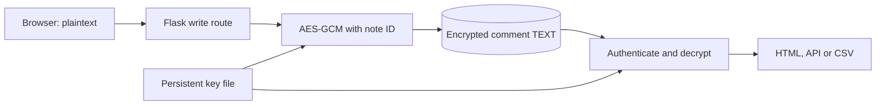

# Session 03 Homework: Encrypting NotesApp Comments

Ziming Chen · Student ID 2023905333 · Verified 8 October 2026

Slide 30 asks for AES-GCM encryption of the NotesApp `comment` column. Comments are now encrypted before INSERT or UPDATE and authenticated and decrypted for display. The column remains `TEXT`; grades and other application data retain their existing values.

## Design

The storage layer uses AES-256-GCM, a persistent 32-byte key, a fresh random 12-byte nonce for every write, and a full 16-byte authentication tag. Each comment has this envelope:

```text
aesgcm:v1:Base64(nonce || ciphertext || tag)
```

Base64 encodes the binary envelope for a text column; AES-GCM provides encryption. Associated data is `notesapp:notes:<id>:comment:v1`. Binding to the note ID rejects a ciphertext copied to another row. New note IDs are allocated before encryption, so no plaintext comment is inserted temporarily. Empty strings are encrypted; SQL NULL remains NULL.



The key is stored at `Cybersecurity/.secrets/notesapp-comment.key`, outside the application directory mounted at `/host`, and supplied as a Compose file secret at `/run/secrets/comment_key`. It is excluded from the repository and submission. The Windows initializer preserves existing keys and records an initialization marker; a missing previously initialized key requires restoration.

Startup migration locks the notes table and processes comments in one transaction. Plaintext rows are encrypted; existing encrypted rows are authenticated without rewriting. A small `notesapp_crypto_state` table records completion. Later starts reject plaintext instead of trusting it as legacy data. A failure rolls back the transaction and prevents startup. Request-time authentication failures return a generic error with no comment plaintext.

## Code

| File | Responsibility |
| --- | --- |
| [comment_crypto.py](../../../web/comment_crypto.py) | Key loading, encryption, authenticated decryption and envelope format |
| [comment_migration.py](../../../web/comment_migration.py) | Atomic migration and repeat-start validation |
| [app.py](../../../web/app.py) | Grade writes; dashboard, teacher page, note API and CSV reads |
| [Initialize-CommentKey.ps1](../../../Initialize-CommentKey.ps1) | Persistent Windows key setup |
| [docker-compose.yml](../../../docker-compose.yml) | Read-only key file supplied to the web service |
| [tests](../../../tests) | Cryptography, migration and route checks on disposable PostgreSQL databases |
| [verify_live.py](verify_live.py) | Encrypted backup and checks of the original application over HTTP |

## Run

On the prepared Windows workstation, double-click `NoteApp/Start-NoteApp.cmd` and open [NotesApp](http://127.0.0.1:8080). From `NoteApp`, the equivalent commands are:

```powershell
powershell -NoProfile -ExecutionPolicy Bypass -File Initialize-CommentKey.ps1
powershell -NoProfile -ExecutionPolicy Bypass -File Initialize-ExportKey.ps1
docker compose -p noteapp -f docker-compose.yml -f compose.windows.yml up -d --build --wait
```

The current application also requires the independent Session 04 export HMAC key. For a fresh Linux checkout, create both keys once before starting Compose:

```bash
mkdir -p ../.secrets
python3 - <<'PY'
import os
from pathlib import Path
for name in ('notesapp-comment.key', 'notesapp-export-hmac.key'):
    key = Path('../.secrets') / name
    with key.open('xb') as stream:
        stream.write(os.urandom(32))
    key.chmod(0o600)
PY
docker compose -p noteapp up -d --build --wait
```

Exclusive creation refuses to overwrite an existing key. Keep the original key with the database: an unrelated replacement cannot decrypt existing comments. Back up an existing database before its first encrypted startup. In the configured Windows environment, `verify_live.py prepare` saves an encrypted SQL dump and comparison snapshot and refuses to overwrite its original baseline. Seed SQL is for an empty volume only.

For automated checks, install `NoteApp/requirements-dev.txt` into a virtual environment, then run from `NoteApp` with the local PostgreSQL service available on port 15432:

```powershell
python -m pytest -q --cov=comment_crypto --cov=comment_migration --cov-branch --cov-report=term-missing --cov-fail-under=95
```

Tests create uniquely named `notesapp_hw_test_...` databases and drop only those databases. `TEST_DB_HOST` and `TEST_DB_PORT` can select another local test server.

## Results

| Verification | Observed result |
| --- | --- |
| Original database | PostgreSQL 15.19; 35 users, 4 classes, 60 enrolments, 60 notes |
| Migration | All 60 formerly plaintext comments are stored as AES-GCM envelopes |
| Preservation | Every comment recovers exactly; other columns and tables match the pre-migration snapshot |
| Live HTTP | Student and teacher pages work; all 60 authenticated API reads return the original comments |
| CSV | Full export and four class exports match the original data and column layout |
| Container restart | All comments still decrypt; stored ciphertexts remain unchanged |
| Automated checks | 39 passed; encryption and migration modules have 100% statement and branch coverage |

The checks cover Unicode, empty and NULL comments, fresh nonces, modified nonce/ciphertext/tag, wrong keys, row swaps, invalid envelopes, rollback, repeated migration, rejection of plaintext after migration, creation and update, every read route, and the complete supplied seed. The final 39 checks passed on PostgreSQL 15.19; the earlier 36-check version also passed on an isolated Windows PostgreSQL 17.6 server. Coverage describes the two new modules, not the whole application or cryptography library.

Evidence: [before migration](results/before_migration.json), [live HTTP](results/live_verification.json), [restart](results/restart_verification.json), [isolated seed checks](results/seeded_verification.json), [test output](results/verification.txt). The original SQL backup and comparison snapshot are encrypted and kept outside the submission.

## Scope

Column encryption detects unauthenticated storage changes and prevents direct plaintext reads of the current column. The teaching application's weak authentication, missing ownership checks, unescaped HTML, plain HTTP, root container and Docker socket mount remain. A request admitted by its access control receives decrypted comments, and a compromised web container can access the key. Encryption does not resolve those threats. Seed SQL, earlier classroom exports and historical PostgreSQL storage may still contain sample plaintext; this migration does not erase those copies. Key rotation is outside this homework.

The earlier Session 02 source and reports are preserved in the local course archive at `Assignments/Session02/pre-homework`; this repository retains the project Git history. The current CSV exporter additionally authenticates its output using the [Session 04 HMAC extension](../../session04/README.md). The results below describe the original Session 03 verification.

References: [AESGCM API](https://cryptography.io/en/46.0.7/hazmat/primitives/aead/#cryptography.hazmat.primitives.ciphers.aead.AESGCM), [Compose file secrets](https://docs.docker.com/compose/how-tos/use-secrets/), [PostgreSQL sequences](https://www.postgresql.org/docs/15/functions-sequence.html).
