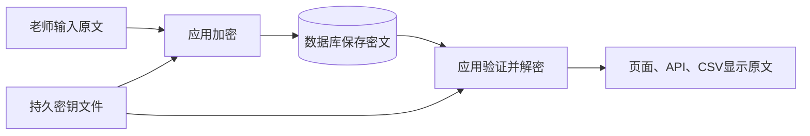

# Session 03 课后作业：给 NotesApp 的评语加密

Homework 已在原 Docker 数据库完成并实测：60 条评语改为 AES-GCM 密文保存，页面仍显示原文。35 个用户、4 门课、60 条选课记录及原成绩保留；容器重启后仍能解密。

## 1. 两个课堂实验和这项作业的关系

**凯撒密码实验**：每个字母固定移动几格，英文的字母出现规律仍然存在。用频率分析猜位移，示例找到的答案是 7。现在直接运行 `docs/session03/lab/caesar.py` 即可自动读取示例；也可以在脚本后指定自己的密文文件。

**ECB 与 GCM 图片实验**：ECB 对相同输入块产生相同输出块，企鹅轮廓仍可辨认；GCM 使用每次加密的新 nonce，并带有认证标签，修改过的密文会被拒绝。Homework 把 GCM 用到真正的应用保存流程中。

## 2. 保存密文，显示原文

原来，老师输入 `Good work`，数据库就保存 `Good work`。现在，应用先加密，数据库保存如下格式；应用读取时验证并解密，再把 `Good work` 发给页面。浏览器不会收到密钥。

```text
aesgcm:v1:Base64(nonce + 密文 + 认证标签)
```



这是 encrypted at rest（保存时加密）：本次针对数据库 `comment` 字段。页面和 CSV 按功能需要仍是原文；成绩没有加密，因为课件只要求评语列。

## 3. 必须理解的术语

| 英文 | 中文 | 本作业的作用 |
| --- | --- | --- |
| plaintext | 明文 | 用户输入和解密后显示的评语 |
| ciphertext | 密文 | 加密后的内容 |
| key | 密钥 | 32 字节，即 256 位；保密且持久保存 |
| nonce | 每次加密的新值 | 随机生成 12 字节，随密文保存；同一密钥下不能故意复用 |
| authentication tag | 认证标签 | 16 字节，用于验证内容及相关信息 |
| associated data / AAD | 附加认证数据 | 把密文绑定到当前记录身份 |

密钥好比开箱工具；nonce 好比每次装箱使用的新编号，它可以公开，但每次加密需要新值；标签帮助发现改动。实际计算由密码库完成。

Base64 是**编码**，只是把二进制转为适合放进 `TEXT` 列的字符；单独做 Base64 不保密。本作业先 AES-GCM 加密，再编码保存。

AAD 使用 `notesapp:notes:7:comment:v1` 这样的身份字符串。第 7 条的密文若被复制到第 8 条，解密时使用第 8 条身份，标签验证就会失败。它不代替权限检查：应用仍要判断谁有权访问第 7 条。

## 4. 从哪里看代码

| 入口 | 重点 |
| --- | --- |
| [comment_crypto.py](../../../web/comment_crypto.py) 的 `encrypt()`、`decrypt()` | nonce、封装格式、标签验证、UTF-8 中文恢复 |
| [comment_migration.py](../../../web/comment_migration.py) | 已有数据如何迁移、验证、回滚 |
| [app.py](../../../web/app.py) 的 `grades()` | 写入前加密，新增前先申请记录 ID |
| 同文件的 `decrypt_notes()` | 学生页、老师页、API、CSV 共用读取逻辑 |
| [Initialize-CommentKey.ps1](../../../Initialize-CommentKey.ps1) | 密钥首次创建及后续保留 |
| [verify_live.py](verify_live.py) | 加密备份、原数据库快照和真实 HTTP 核对 |
| [tests](../../../tests) | 独立数据库中的创建、修改、异常和回滚检查 |

保存和读取都要修改：只加密保存，页面就会显示密文；只修改显示，数据库仍是原文。

新增记录先通过 PostgreSQL sequence（序列）申请 ID，再把 ID 放进 AAD 并加密，最后 INSERT。这样没有先把明文插入数据库的中间步骤。序列允许编号空缺，不保证编号连续。

## 5. 旧评语怎样处理

迁移前已把原 SQL 备份及核对快照加密保存在 `.secrets/backups`。真实密钥和这些备份不进入提交包。

启动迁移使用 transaction（事务）：锁住 `notes` 表，逐条加密原明文；已是当前加密格式的记录只验证。若有错误，整次 rollback（回滚），不留下只迁移前半部分的状态。

重启后，60 条记录只验证、不重新加密，密文保持不变。这叫 idempotent（幂等）。`notesapp_crypto_state` 小表保存迁移完成标记；完成后若再次出现明文，启动会拒绝，不把它当成旧数据重新加密。错误密钥、坏标签和损坏格式也会失败，不会回退成“当作明文显示”。

空字符串 `""` 与 SQL NULL 不同：空字符串也加密；NULL 表示没有值，本次保留为 NULL。

## 6. 运行与检查

双击 [Start-NoteApp.cmd](../../../Start-NoteApp.cmd)，访问 [本机 NotesApp](http://127.0.0.1:8080)。停止时双击 [Stop-NoteApp.cmd](../../../Stop-NoteApp.cmd)，数据库卷与密钥保留。

本机 Docker 使用原专用目录 `C:/Users/lenovo/Documents/DockerDesktopRuntime`。引擎未就绪时，启动脚本会调用恢复检查；相关说明在 本地课程目录中的 `Support/DockerDesktop/README_STUDY.zh-CN.md`。

自动检查：

```powershell
cd D:\AAAdile\Work\Cybersecurity\NoteApp
python -m pytest -q --cov=comment_crypto --cov=comment_migration --cov-branch --cov-report=term-missing --cov-fail-under=95
```

测试创建自己的 `notesapp_hw_test_...` 数据库并在结束后清理，原应用数据库不会重置。其他电脑按英文报告安装 `requirements-dev.txt`。

重新核对当前数据库、页面和 API：

```powershell
python docs/session03/homework/verify_live.py check --results-dir docs/session03/homework/results/recheck
```

`prepare` 是首次迁移前的备份步骤，已有基准时拒绝覆盖；本机已经执行，不必重复。`restart` 核对容器重启后的结果，并与重启前的密文摘要比较。

直接观察字段可用只读查询：

```powershell
docker compose -p noteapp -f docker-compose.yml -f compose.windows.yml exec -T db psql -U notesapp -d notesapp -c "SELECT id, grade, LEFT(comment, 35) AS stored_comment FROM notes ORDER BY id LIMIT 3;"
```

前缀 `aesgcm:v1:` 只说明存储格式；成功解密和拒绝篡改的检查才是加密行为的进一步证据。

## 7. 本次验证结果

| 证据 | 结论 |
| --- | --- |
| [before_migration.json](results/before_migration.json) | 原数据库有 60 条明文评语；加密备份可解密 |
| [live_verification.json](results/live_verification.json) | 原 60 条评语恢复完全一致，其他列和表不变；真实页面、API、CSV 核对通过 |
| [restart_verification.json](results/restart_verification.json) | 容器重启后继续解密；存储密文与重启前相同 |
| [verification.txt](results/verification.txt) | PostgreSQL 15.19 上最终 39 项检查通过，两个新增模块覆盖率 100% |
| [seeded_verification.json](results/seeded_verification.json) | 独立数据库中的完整样本、迁移和读取验证 |

PostgreSQL 17.6 上前期 36 项隔离验证的记录以 `.windows` 文件名保留。`seeded_verification` 检查的是独立测试数据；原数据库已迁移的证据是 `live_verification`。

100% 覆盖率表示两个模块的代码路径被本次检查走到，不代表密码库没有漏洞，也不代表整个应用已经安全。

## 8. 密钥与剩余风险

密钥在 `D:/AAAdile/Work/Cybersecurity/.secrets/notesapp-comment.key`，由容器只读 secret 文件加载，不在源码和提交包中。`.key.created` 标记用于发现初始化后密钥文件被丢失。

**保留原密钥和备份。** 新随机密钥不能打开旧密文。密钥丢失时需要恢复原文件，不能靠重新生成密钥恢复原评语。

课堂应用原有的弱认证、越权、未转义 HTML、明文 HTTP、root 容器和 Docker socket 挂载仍然存在。比如，越权 API 若放行请求，应用会替它解密；攻陷应用容器也可能拿到密钥。这些仍是 Project 1 的分析对象。

原始种子 SQL、第二节课 CSV 和 PostgreSQL 历史存储可能仍有样本明文；这次不声称清除了全部历史副本。第二节课源码与报告已保存在 `Assignments/Session02/pre-homework`，Git 历史保留在 `NoteApp`。

## 9. 自测

1. 数据库是密文，为什么页面仍能显示原文？解密在哪个进程发生？
2. 相同评语保存两次，为什么应该得到不同密文？
3. key 和 nonce 哪个需要保密？哪个每次更新？
4. 把第 1 条密文复制到第 2 条，AAD 为什么使验证失败？
5. 标签验证失败时，为什么不能忽略错误继续显示？
6. 为什么列加密不能代替访问权限检查和 HTTPS？

要求来源：Session 03 课件第 30 页。参考：[AESGCM 文档](https://cryptography.io/en/46.0.7/hazmat/primitives/aead/#cryptography.hazmat.primitives.ciphers.aead.AESGCM)、[Compose secrets 文档](https://docs.docker.com/compose/how-tos/use-secrets/)。
