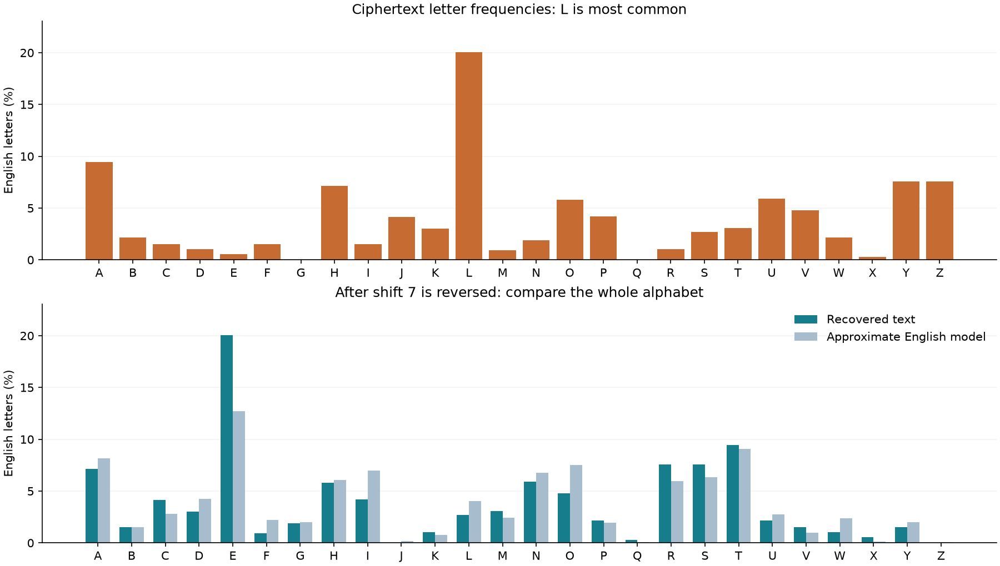
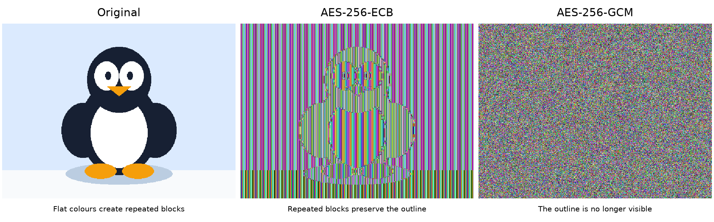

# Session 03：对称加密讲解与实验学习说明

这一节课围绕一个问题展开：**如果有人复制了数据库，能不能让他读不懂里面的内容？**

以前的 NotesApp 把评语直接存在数据库里。比如 `Good work, but late twice`，拿到数据库文件的人就可能直接读到。加密把可读内容变成密文，正常使用者通过密钥还原它。它主要解决这里的数据保密问题；拿到应用权限的人、窃取了密钥的人，仍可能读取内容。

本次完成第 30 页的两项课堂实验。输入文字和企鹅图片都是实验自建样本；课件未提供需要破解的具体密文或原图。英文 `README.md` 记录方法与实测结果，本文用来理解和复现。课件原件在 `../../Materials/Session03_Symmetric_Encryption.pdf`。

## 1. 先认清几个词：第 5–8 页

| 英文 | 中文 | 在当前例子里的意思 |
| --- | --- | --- |
| Plaintext | 明文 | 原本可以读懂的 `Good work` |
| Ciphertext | 密文 | 加密后的字节数据 |
| Key | 密钥 | 控制加密、解密的秘密数据 |
| Encryption | 加密 | 把明文变成密文 |
| Decryption | 解密 | 使用密钥把密文还原 |
| Symmetric encryption | 对称加密 | 加密和解密使用同一把密钥 |

可以把它想成门锁：同一把钥匙既能锁门，也能开门。这里的“同一把”指同一份密钥数据。算法是计算方法，密钥是这个方法的秘密输入，两者不同。

```text
明文 + 密钥 --加密--> 密文
密文 + 同一密钥 --解密--> 明文
```

密文不一定是乱码字符串。程序通常得到一串 bytes（字节）；为了存进文本字段，可能再做 Base64 编码。**编码（encoding）不等于加密**：Base64 不需要秘密密钥，别人照样能解码。

第 8 页讲 Kerckhoffs's principle（柯克霍夫原则）：即使别人知道使用的算法，系统也应该靠密钥继续保密。因此，可以使用公开、经过研究的算法，而不是把“别人不知道我怎么写的代码”当作保护。第 9 页的历史例子服务于这个原则，不需要把密码安全理解成只要隐藏算法名称就够了。

## 2. 凯撒密码为什么容易破解：第 10–14 页

Caesar cipher（凯撒密码）把每个英文字母固定移动若干格。向后移动 3 格时：

```text
原字母： A B C ... X Y Z
新字母： D E F ... A B C

HELLO -> KHOOR
```

字母按环排列，超过 Z 就回到 A。用编号表示，A=0，B=1，…，Z=25：

```text
加密：新编号 = (原编号 + 位移) mod 26
解密：原编号 = (新编号 - 位移) mod 26
```

`mod` 是取余数，Python 写作 `%`。例如 `(25 + 3) % 26 = 2`，所以 Z 变成 C。位移 0 不改变文字，因此有 25 种真正改变文字的位移；程序检查 0 到 25 共 26 个候选。

它有两个明显弱点。第一，候选位移太少，逐个尝试很容易，这叫 brute force（穷举）。第二，每个字母总被换成同一个字母，字母出现次数仍然保留，这让 frequency analysis（频率分析）成为可能。

长篇普通英文里，E 往往比较常见。课件的办法是先猜：“密文里最高的那根柱子，对应原文 E。”本次密文的最高频字母是 L，那么：

```text
E 的编号 = 4
L 的编号 = 11
位移 = (11 - 4) % 26 = 7
```

这里“最常见的是 E”是统计经验，并非每段文字的规则。`HELLO` 里出现最多的是 L。只有几个字母的消息、某个单词反复出现的消息、非英文消息，都可能让这条经验失效。

### 实验一的做法与结果

`caesar.py` 实现了两个层次：`most_common_guess()` 先使用课件的最高频字母猜测；`rank_candidates()` 再对 26 个候选计算 chi-square（卡方）分数，比较**整套字母的出现比例**是否接近英文。

卡方分数可以先理解成“离典型英文频率有多远”，越小越接近：

```text
某个字母的期望次数 = 字母总数 × 英文模型里的比例
这个字母贡献的分数 = (实际次数 - 期望次数)² / 期望次数
总分 = 把 26 个字母的贡献相加
```

程序不是查找已知答案。攻击函数只接收密文，使用通用字母频率表；选好候选后，`run_lab.py` 才读取留存的原文进行核对。

本次实测：

| 检查项 | 结果 |
| --- | --- |
| 英文字母总数 | 1,067 |
| 最高频密文字母 | L，共 214 次 |
| 假设最高频对应 E | 猜出位移 7 |
| 全字母频率评分第一名 | 位移 7，分数 136.498 |
| 第二名 | 位移 18，分数 2,778.014 |
| 恢复文本与原文比较 | 完全一致，大小写与标点也保留 |



看图时先看上半部分：横轴是 A–Z，纵轴是字母出现比例，L 的柱子最高。下半部分已经逆向移动 7 格，E 重新成为高峰。两组柱子分别是恢复文本的实际比例和英文模型；它们不会完全一样，评分是比较整体形状。

第一名比第二名低很多，且恢复后能读成英文，这支持位移 7 的判断。留存原文让我们进一步确认了这次实验的答案。但分数差距本身不是普遍正确性的证明。

如果只想看三个候选和恢复的文字，运行：

```powershell
.\.venv\Scripts\python.exe caesar.py
```

输出 `shift` 是位移，`chi-square` 是分数。可以在 `results/caesar_candidates.csv` 中查看全部 26 个结果，在 `results/caesar_recovered.txt` 中查看恢复的全文。

在 VS Code 打开 `caesar.py` 后直接点“运行 Python 文件”也可以：不传参数时自动读取脚本旁边的 `data/caesar_ciphertext.txt`，不受终端当前目录影响。要分析自己的密文，运行 `python caesar.py 你的密文文件路径`。原先的 `the following arguments are required: ciphertext` 表示缺少命令行参数；这里已为直接运行提供默认输入。

## 3. Vigenère 和 XOR：第 15–18 页

### Vigenère：用一个单词轮流改变位移

Vigenère cipher（维吉尼亚密码）不让整篇文字共用一个位移，而是让一个关键词重复出现。

```text
明文： A T T A C K
密钥： L E M O N L
密文： L X F O P V
```

例如，L 对应位移 11，E 对应位移 4。两个 T 位于不同位置，遇到不同的密钥字母，所以会变成 X 和 F。直接给整篇密文数字母，就没有凯撒密码那么简单了。

但关键词如果长度为 5，第 1、6、11…个位置仍用同一个位移。猜到密钥长度以后，可以按位置把文字分成 5 组，每组分别分析。课件说的“拆成几个凯撒密码”指的就是这件事。本次实验不要求实现 Vigenère 破解。

### XOR：一种可逆的位运算

计算机最终处理 0 和 1。XOR（exclusive OR，异或）按位计算：“两个位不同得 1，相同得 0。”

| a | b | a XOR b |
| --- | --- | --- |
| 0 | 0 | 0 |
| 0 | 1 | 1 |
| 1 | 0 | 1 |
| 1 | 1 | 0 |

```text
明文： 0101
密钥： 0011
异或： 0110  <- 密文

密文： 0110
密钥： 0011
异或： 0101  <- 原文又回来了
```

所以 `(message XOR key) XOR key = message`。Python 对整数使用 `^` 表示异或。AES 等现代密码内部也使用类似的位运算，但“随便拿一个密码字符串反复 XOR”不是安全的现代加密方案。

One-time pad（一次一密）要求密钥真正随机、至少覆盖消息长度、保持秘密，并且只使用一次。在这些严格条件下，它具有理论上的完美保密性。困难在于：一份很长的消息也需要很长的秘密密钥，还要安全地分发它。

如果同一份密钥被用于两条消息：

```text
c1 = m1 XOR key
c2 = m2 XOR key
c1 XOR c2 = m1 XOR m2
```

密钥被抵消，两条明文之间的关系暴露了。它不代表攻击者立刻知道两条全文；但如果他知道一条明文，就能进一步还原另一条。这也是为什么课件反复强调“不要重用”。

## 4. AES 很强，为什么还需要选模式：第 19–24 页

AES 是 Advanced Encryption Standard（高级加密标准）。它是公开的现代分组密码。本实验使用 AES-256，意思是密钥长度为 256 bits（位），即 32 bytes（字节）。

先区分两个长度：

| 项目 | 长度 | 含义 |
| --- | --- | --- |
| AES 的分组 | 固定 128 位 = 16 字节 | 每次基础运算处理多大的数据块 |
| AES 的密钥 | 128、192 或 256 位 | 秘密密钥的大小 |
| 本实验的 AES-256 密钥 | 256 位 = 32 字节 | 本次选用的密钥大小 |

**AES-256 并不表示每块数据有 256 位**。[NIST 的 AES 标准](https://csrc.nist.gov/pubs/fips/197/final)明确区分了这些大小。课件以 AES-128 的 `2^128` 种密钥说明穷举很难；实际安全还依赖算法用法、密钥管理和程序实现。

图片比 16 字节大得多，因此程序需要安排很多数据块如何一起加密。这种安排叫 mode of operation（工作模式）。ECB 和 GCM 都可以使用 AES，但会产生不同的安全性质。

### ECB：相同块总变成相同块

ECB 是 Electronic Codebook（电子密码本）模式。它把每个块单独加密。

```text
原块：      A  A  B  A  C  C
ECB 密文：  X  X  Y  X  Z  Z
```

不知道密钥的人也许不知道 A 是什么，但仍然知道哪些位置相同。单色图片的背景会出现大量相同块，企鹅身体和肚子也各自有重复块。颜色改变了，区域的边界还在，所以还能认出企鹅。[cryptography 的 ECB 说明](https://cryptography.io/en/46.0.7/hazmat/primitives/symmetric-encryption/#cryptography.hazmat.primitives.ciphers.modes.ECB)描述的就是这种重复泄露。

这次没有破解 AES 密钥；我们观察到的是 ECB 工作模式泄露了结构。在新应用中不应选 ECB 来保护这些内容。

### GCM：保密，同时检查篡改

GCM 是 Galois/Counter Mode（伽罗瓦/计数器模式）。入门时先记住两项作用：

- Confidentiality（保密性）：持有密钥的人能读回内容，别人不能直接读。
- Integrity（完整性）：收到的数据若被修改，认证检查会拒绝它。

GCM 会产生 authentication tag（认证标签）。解密时会检查标签，失败就抛出 `InvalidTag`，而不是把错误内容当作正常明文返回。它不是把别人随手算一个普通校验和就可以伪造的标签。

标签也不能证明“这条消息一定是某个具体人写的”：持有同一对称密钥的人都可以生成有效标签。身份验证是另一个层次的问题。

课件说 GCM 图像呈噪声，是在说明可见图案不再保留；不要将它扩大理解为“任何信息都不泄露”。密文长度、这里保留的图片尺寸等信息仍可见，零重复块也不是对所有输入的数学保证。

### 实验二具体加密了什么

PNG 是一种图片文件格式，包含文件头和压缩数据。直接把整个 PNG 加密，再交给图片查看器，通常会因为文件格式损坏而打不开。为了直观看出结构，我们这样做：

```text
读取原图 -> 转成 RGB -> 取出像素字节 -> 加密
                  已知宽高 + 密文字节 -> 当作 RGB 显示
```

RGB 表示 red、green、blue，每个像素占 3 字节。原图是 `512 × 384`，所以有：

```text
512 × 384 × 3 = 589,824 字节
589,824 ÷ 16 = 36,864 个 AES 大小的数据块
```

ECB 需要 padding（填充），把数据凑成完整块。这里使用 PKCS#7；原数据刚好对齐时仍然添加一个完整填充块，所以完整 ECB 密文是 589,840 字节。展示图片时只取原像素长度，完整密文仍留在 `.bin` 文件中。

GCM 不需要这种填充，但 `AESGCM.encrypt()` 的返回值附带 16 字节标签，因此本实验的 GCM 返回值也恰好是 589,840 字节。两者长度相等是这份输入里的巧合，增加的 16 字节含义不同。展示 GCM 图片时排除标签。[AESGCM 官方文档](https://cryptography.io/en/46.0.7/hazmat/primitives/aead/#cryptography.hazmat.primitives.ciphers.aead.AESGCM)说明了返回格式和认证失败行为。



从左到右读图：左边是原图；中间仍能看到轮廓，是 ECB 的结构泄露；右边是 GCM 密文字节的可视化。右图呈噪声不表示图片数据丢失了，使用正确密钥与 nonce 仍然能恢复原图。

| 检查项 | 原像素 | ECB 密文视图 | GCM 密文视图 |
| --- | ---: | ---: | ---: |
| 完整数据块数 | 36,864 | 36,864 | 36,864 |
| 不同内容的数据块数 | 205 | 205 | 36,864 |
| 超过首次出现的重复次数 | 36,659 | 36,659 | 0 |

比如 `A A A B B` 总共 5 块，只有 2 种不同内容，重复次数是 `5 - 2 = 3`。它不是说“有三种重复块”。本次 ECB 的唯一块数等于原图，是因为同一密钥下，相等块仍相等，不同块也不会被 AES 映射成同一块。

另有五类实测检查：两种模式都成功恢复原像素；修改 GCM 密文、标签、nonce 或密钥都触发了 `InvalidTag`。ECB 修改第一个内容块后仍然返回了被改坏的像素，它没有认证标签。修改 ECB 的填充区有时会导致填充错误，但这不能替代完整性保护。

恢复后的图片是 `results/ecb_decrypted.png` 和 `results/gcm_decrypted.png`。程序逐字节比较像素是否相同，并记录 SHA-256 摘要；两者都与原像素一致。这里摘要用于核对文件，不是把摘要当成加密。

## 5. Nonce、tag 与 key：第 25–28 页

| 名称 | 中文理解 | 是否需要保密 | 本实验大小 |
| --- | --- | --- | --- |
| Key | 真正的秘密密钥 | 是 | 32 字节 |
| Nonce | 每次加密使用的一次性值 | 否 | 12 字节 |
| Tag | 解密时检查数据是否被改的认证标签 | 否 | 16 字节 |

nonce 可以和密文放在一起；解密时需要它。它不是密码，不需要靠隐藏来保护。关键要求是：**同一个 GCM 密钥下，每次加密必须使用不重复的 nonce**。复用同一 `key + nonce` 会破坏保密性和认证保护。

本实验每次运行生成新密钥，使用 `os.urandom(12)` 生成 nonce；每个 GCM 实验密钥只加密一次。测试还验证了同一测试密钥的两次调用使用不同 nonce。随机取值不意味着数学上绝不碰撞；长期大量加密时需要设计 nonce 唯一性、使用量与密钥更换规则。

以下是理解 GCM 所需的最短例子，可以在 Python 交互窗口尝试：

```python
import os
from cryptography.hazmat.primitives.ciphers.aead import AESGCM

key = AESGCM.generate_key(bit_length=256)  # 创建随机密钥
nonce = os.urandom(12)  # 为这次加密创建 nonce
aes = AESGCM(key)
encrypted = aes.encrypt(nonce, b"Good work", None)
recovered = aes.decrypt(nonce, encrypted, None)
print(recovered)  # b'Good work'
```

`b"Good work"` 的 `b` 表示 bytes。最后的 `None` 表示本例没有 additional authenticated data（额外认证数据，AAD）。如果指定了 AAD，解密时也要提供相同的 AAD；它被认证，但不会被加密。这里不需要先掌握 AAD 才能完成实验。

第 27 页提出另一个问题：如果密钥硬编码在程序里，又跟数据库一起被拿走，数据加密也挡不住读取。加密把重点转移到了密钥保护。本次实验的密钥只在程序内存里存在，不保存、不打印；所以保存的 `.bin` 密文不能在程序结束后单独解密。程序已经在运行中完成解密核对，重新运行会重新生成密钥。

第 28 页问“从没见过面的两个人怎么安全共享密钥”。如果直接在可能被监听的渠道发密钥，监听者也拿到了。这需要额外的密钥分发或协商机制，并需要确认对方身份。对称加密本身不能替你完成这些步骤；课件后续内容才继续讨论。

## 6. 怎么运行、从哪里看代码

此仓库副本位于 `docs/session03/lab`；本地原始实验仍保留在课程目录的 `Assignments/Session03`。两份实验都不依赖 Docker。首次运行此副本时，按下方命令创建虚拟环境并安装依赖。

最简单的运行办法是双击 `Run-Lab.cmd`。命令行运行可以打开 PowerShell，输入：

```powershell
Set-Location docs/session03/lab
.\.venv\Scripts\python.exe run_lab.py
```

这会更新 `results` 下的实验结果。加密颜色和 nonce 会变化，因为每次都生成随机密钥与 nonce；凯撒位移、原文恢复、ECB 轮廓泄露等结论可以复现。

如果迁移到另一台有 Python 3.12 的电脑：

```powershell
python -m venv .venv
.\.venv\Scripts\python.exe -m pip install -r requirements.txt
.\.venv\Scripts\python.exe run_lab.py
```

`.venv` 是 virtual environment（虚拟环境），用于为这个项目放置 Python 工具和依赖。`requirements.txt` 是 dependency list（依赖列表）。复制或提交项目时不需要包含 `.venv`；另一台电脑可以用上述命令重建。

按下面顺序读代码，比从第一行一直读到底更容易理解：

| 入口 | 重点看什么 |
| --- | --- |
| `caesar.py` 的 `encrypt()` | 用 `ord` / `chr` 在字母和编号间转换，`% 26` 实现绕回 |
| `letter_counts()` | 只统计英文 26 字母，忽略大小写 |
| `most_common_guess()` | 把最高频密文字母暂时当作 E |
| `rank_candidates()` | 对所有位移统计并评分，排序后挑分数最低的 |
| `image_modes.py` 的 `encrypt_ecb()` | 先填充，再用 AES-ECB 加密 |
| `encrypt_gcm()` / `decrypt_gcm()` | 创建 nonce，加密与认证，检查后返回明文 |
| `run_image_lab()` | 读取像素、加密、解密、篡改测试、保存证据 |
| `run_lab.py` 的 `run_lab()` | 串起两项实验，输出表格、图和日志 |
| `make_inputs.py` | 生成自建输入；这里的位移 7 是样本制作信息，攻击不读取此文件 |

常见 Python 写法也可以这样理解：`Path` 管理文件路径；`read_text()` 读取文字；`tobytes()` 取出像素字节；`==` 检查是否相等；`try / except InvalidTag` 表示“尝试解密，如果认证失败，就记录被拒绝”。

关键结果文件：

| 文件 | 用途 |
| --- | --- |
| `results/image_comparison.png` | 直接展示原图、ECB 和 GCM |
| `results/caesar_frequency.png` | 理解频率分析 |
| `results/caesar_candidates.csv` | 查看全部位移的分数 |
| `results/metrics.json` | 本次实际环境、测量数字与真假值 |
| `results/run_log.txt` | 最短的实验运行结果 |
| `results/verification.txt` | 自动测试与覆盖率记录 |

JSON 中 `true` 表示这项检查通过；`false` 表示没有通过。CSV 可以用表格软件打开。图用于直观解释，逐字节比较和测试记录用于核对程序行为；两者结合看。

自动检查命令如下：

```powershell
.\.venv\Scripts\python.exe -m pip install -r requirements-dev.txt
.\.venv\Scripts\python.exe -m pytest --cov=. --cov-report=term-missing --cov-fail-under=80
```

本次 52 项检查全部通过，三个实验模块的语句和分支合计覆盖率为 98.85%；统计包括命令行启动的子进程，不包括样本生成辅助脚本。测试检查了凯撒所有 26 个位移、字母环绕、无英文文本的错误提示、不同长度数据的加解密、ECB 重复块、GCM 篡改与错误输入、非对齐图片，以及从其他目录启动实验。通过测试说明这些行为得到验证，不等于对整个密码库做了安全审计。

## 7. 做完后可以用这些问题检查理解

先自己回答，再看提示。不必一次做完所有题。

1. `HELLO` 用位移 3 加密为什么得到 `KHOOR`？Z 移动 3 格变成什么？
2. 英文密文里 L 出现最多，为什么可以先猜位移 7？为什么这个猜测不是必然正确？
3. 图里的 ECB 企鹅还认得出来，代表 AES 的密钥被破解了吗？
4. AES-256 的密钥多少字节？基础数据块又是多少字节？
5. GCM 的 nonce 可以和密文一起存吗？同一密钥能复用 nonce 吗？
6. 改一个 GCM 密文字节后，为什么程序应该报 `InvalidTag`，而不是照常显示内容？
7. 同一个 `Good work` 加密两次，密文可以不同吗？解密结果应该怎样？
8. 如果数据库和密钥都被偷了，单靠数据库加密还够吗？

<details>
<summary>查看答案提示</summary>

1. 每个字母向后 3 格；Z 绕回成为 C。
2. L 和 E 的编号差是 7；最高频对应 E 是语言统计经验，短文和特殊文本会例外。
3. 没有破解密钥。ECB 泄露了相同块的位置与结构。
4. 密钥是 32 字节；数据块固定是 16 字节。
5. nonce 不秘密，可以存一起；同一密钥下不能复用。
6. 标签检查发现认证失败，拒绝把修改后的数据当成正常明文。
7. 可以，正确使用新的 nonce 时密文通常不同；正确解密都应回到 `Good work`。
8. 不够。密钥保护、访问控制和应用安全仍然需要处理。

</details>

一个短练习：把 `Hello, World!` 用位移 3、7、25 分别加密，自己对照字母表确认；再看看 `caesar.py` 的频率攻击对短句是否猜对。猜错反而能帮你理解频率方法的边界。

## 8. 第 29–32 页：实验、课后作业和 Project 1 的区别

| 项目 | 课件要求 | 本次范围 |
| --- | --- | --- |
| 课堂实验 1 | 写凯撒密码，用频率分析在未知密钥时恢复消息 | 已实现并实测 |
| 课堂实验 2 | 同一图片分别用 AES-ECB、AES-GCM 加密，比较效果 | 已实现并实测 |
| NotesApp 课后作业 | 用 AES-GCM 加密数据库 `comment` 列 | 独立的应用修改任务 |
| Project 1 | 数据流图与信任边界、STRIDE 威胁表、可能性 × 影响评分、前三项风险与修复 | 独立的小组项目 |

第 31 页写明 Project 1 为 3–4 人小组，占总成绩 15%；10 月 20 日前在 GitHub 提交，10 月 20 日做 3 分钟小组展示。这些是课件要求，不表示本次已经提交或完成了小组项目。

STRIDE 的威胁分析回答“可能从哪里出问题”，这一节加密则演示一种保护内容的方法。加密可降低数据库副本泄露造成的部分风险，但不自动修复越权访问、SQL 注入、密钥泄露等其他风险。

读完先记住四件事：**同一密钥加密和解密；算法可以公开、密钥要秘密；实际保护内容时优先采用正确使用的认证加密；同一 GCM 密钥的 nonce 不能复用。**
