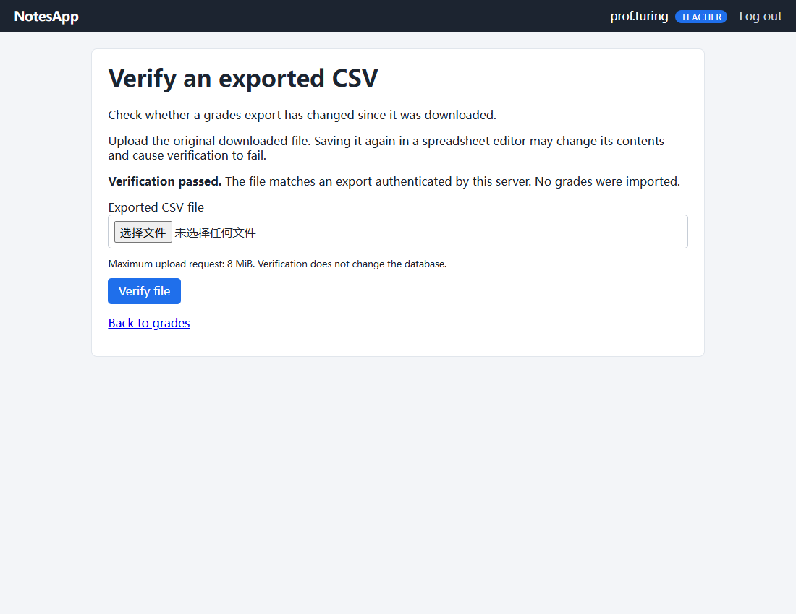
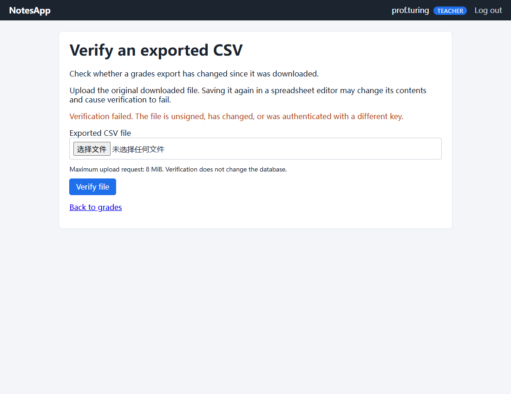

# Session 04: HMAC Protection for Grades Exports

**Full name:** 陈子明 Chen Ziming

**CHU Student ID:** 2023905333

Verified 21 October 2026.

Grades downloaded from NotesApp now carry an HMAC-SHA-256 authentication code. A teacher can upload an export to verify whether its bytes have changed. Changing a grade while keeping the original code causes verification to fail. Verification does not import grades or modify the database.

This implements the application example on content page 13 of [Class 4 — Hashing, integrity & asymmetric encryption](https://docs.google.com/presentation/d/15MDwQCGOYG8WHOMJdrH5M2d2HxxsfuDDLH2ksKZuq7M/edit), assessed as the Class 4 HMAC-signed CSV export homework.

## File format

Both the full export and class-specific exports retain their four data columns:

```text
student,class,grade,comment
```

The payload is UTF-8, with the Python CSV writer's CRLF record separators and quoting rules. Comments are decrypted by the existing AES-GCM storage layer before export. The server appends exactly one metadata line after the CSV payload:

```text
# HMAC: v1:sha256:<64 lowercase hexadecimal characters>
```

The final line also ends in CRLF. Its authentication input is:

```text
HMAC-SHA-256(export_key, b"notesapp:grades-export:v1\x00" || csv_payload_bytes)
```

The trailer itself is excluded. The fixed context identifies this application and format version. Verification locates only the fixed-length final trailer, checks its exact syntax, recomputes the HMAC, and uses `hmac.compare_digest` to compare values. No whitespace, encoding, or line-ending normalization occurs before verification. A marker inside a quoted multiline comment is ordinary authenticated payload, not a trailer.

The last line is metadata, not a fifth column or a grade record. Generic CSV readers do not automatically skip it: authenticate the complete file first, then parse the payload bytes returned by `ExportAuthenticator.verify`. Old unsigned exports are rejected. Renaming a file does not change its authenticated contents; resaving it in a spreadsheet editor can change the bytes and invalidate the HMAC.

## Key and application integration

The export key is a separate, persistent random 32-byte value at `Cybersecurity/.secrets/notesapp-export-hmac.key`. It is not the comment-encryption key, JWT secret, or session key. Compose supplies it read-only at `/run/secrets/export_hmac_key`; `NOTESAPP_EXPORT_HMAC_KEY_FILE` selects the path. There is no hardcoded fallback. Missing or incorrectly sized keys prevent application startup.

`Initialize-ExportKey.ps1` creates the key exclusively, preserves an existing valid key, and records an initialization marker. If a previously initialized key is missing, it requires restoration rather than silently creating a replacement that would invalidate old exports. The key is outside the application tree and excluded from the repository and package. Keep a protected backup; key rotation is not implemented here.

The teacher page links to the full export and `/verify-export`. The new form requires a teacher session and a session-bound CSRF token. Uploaded bytes are checked without being stored as application files, executed, imported, or displayed as HTML. Flask's total request limit is 8 MiB. A valid file returns HTTP 200, an invalid file returns HTTP 400, and an oversized request returns HTTP 413. The verifier does not return an expected authentication code.

| Code | Responsibility |
| --- | --- |
| [export_hmac.py](../../web/export_hmac.py) | Independent key loading, trailer construction, exact-byte verification |
| [app.py](../../web/app.py) | Authenticated export and teacher verification route |
| [verify_export.html](../../web/templates/verify_export.html) | Upload form and verification result |
| [Initialize-ExportKey.ps1](../../Initialize-ExportKey.ps1) | Persistent Windows key initialization |
| [docker-compose.yml](../../docker-compose.yml) | Runtime secret mount |
| [unit tests](../../tests/test_export_hmac.py) / [route tests](../../tests/test_export_routes.py) | Byte changes, malformed files, sessions, upload limits, and database preservation |

## Run and demonstrate

On the prepared workstation, run `NoteApp/Start-NoteApp.cmd`. The launcher initializes both required key files and starts the existing Compose project. Open [NotesApp](http://127.0.0.1:8080), sign in with the course teacher account, and choose **Export all grades** or a class's **export CSV** link. Choose **Verify an exported CSV** to upload the original file.

The following saved files provide a repeatable demonstration:

- [grades_original.csv](results/grades_original.csv): authentic 60-record export; verification passes.
- [grades_tampered.csv](results/grades_tampered.csv): the first grade is increased by one while the original HMAC remains; verification fails.
- [grades_unsigned.csv](results/grades_unsigned.csv): same original payload with no HMAC; verification fails.

Only the demonstration file is edited; no grade in the running database is changed.

These captured files authenticate under the workstation's private export key. That key is deliberately not distributed. A fresh installation generates its own exports; it cannot validate samples created under another installation's key. For a portable, database-free demonstration using a fresh temporary in-memory key, run `python demo_hmac.py` from this directory. It checks both an original and a changed grade without exposing or saving the key.

For a fresh Windows checkout, run the launcher from the repository directory. For a fresh Linux checkout, create both independent keys before Compose starts:

```bash
mkdir -p ../.secrets
python3 - <<'PY'
import os
from pathlib import Path
for name in ('notesapp-comment.key', 'notesapp-export-hmac.key'):
    path = Path('../.secrets') / name
    with path.open('xb') as stream:
        stream.write(os.urandom(32))
    path.chmod(0o600)
PY
docker compose -p noteapp up -d --build --wait
```

These initialization commands are for a fresh checkout only and refuse to overwrite keys. When reusing a database or previously exported files, restore the original keys instead. A new checkout uses the demonstration seed; it is not a copy of the workstation's database.

## Verification

Run the automated suite from `NoteApp` after installing `requirements-dev.txt`, with the local PostgreSQL test service available on port 15432:

```powershell
python -m pytest -q --cov=export_hmac --cov=comment_crypto --cov=comment_migration --cov-branch --cov-report=term-missing --cov-fail-under=95
```

Tests create and drop uniquely named disposable databases, not the running application's database. The full seed test checks all 60 records. The updated previous-session tests authenticate the export and parse only its CSV payload.

| Check | Observed result |
| --- | --- |
| Full export | 60 records; data matches the live database |
| Four class exports | 16, 10, 23, and 11 records; each HMAC valid |
| Original / altered grade | HTTP 200 / HTTP 400 |
| Missing HMAC, wrong key, appended data | HTTP 400 |
| Quoted multiline comments, Unicode, embedded marker text | Exact payload preserved in unit tests |
| Empty class, malformed trailers, changed line endings, truncated files | Covered by automated tests |
| Authentication / CSRF / size limits | Anonymous and student access denied; invalid CSRF rejected; oversized upload rejected |
| Container restart | A previously downloaded export still verifies |
| Existing records | Users 35, classes 4, enrolments 60, notes 60; table digests match before and after |
| Browser | Teacher login, real download, valid and altered upload checks passed in headless Chrome; mobile form fits the viewport |

The HMAC module has 100% statement and branch coverage; the two existing comment-crypto modules also retain 100%. This is not whole-application coverage. [Test output](results/verification.txt) records the test count and coverage. [HTTP evidence](results/live_verification.json), [restart evidence](results/restart_verification.json), and [browser evidence](results/browser_verification.json) record the actual environments and checks.

The local verification helpers are [verify_live.py](verify_live.py) and [verify_browser.py](verify_browser.py). `verify_live.py prepare` creates the pre-change baseline exclusively; do not overwrite it when repeating checks. Later use `verify` or `restart`. Browser verification additionally needs Playwright and an installed Chrome or Edge executable; it is not a runtime dependency of NotesApp.

The [Session 03 HTTP verification helper](../session03/homework/verify_live.py) also authenticates current exports before parsing them. Its optional `--results-dir` writes new regression evidence separately, preserving the original Session 03 verification files. The earlier helper is retained in the local course archive's baseline snapshot; previously packaged Session 03 submissions are unchanged.





## Limits

HMAC authenticates the export bytes under the server's key. It does not encrypt the CSV, establish whether a grade is correct, prove that an export is the latest one, or provide a public digital signature. A holder of the server key can create a new valid HMAC. Earlier unsigned exports remain unsigned.

This change does not resolve the teaching application's weak authentication/session configuration, missing class ownership checks, plaintext HTTP, unescaped grade comments, CSV formula risks, or broad container permissions. Those are separate source findings from the course project. The new verifier avoids adding database-write or arbitrary-file execution behavior.

References: [Python HMAC](https://docs.python.org/3/library/hmac.html), [Flask upload limits](https://flask.palletsprojects.com/en/stable/patterns/fileuploads/), [RFC 2104](https://www.rfc-editor.org/rfc/rfc2104.html).
