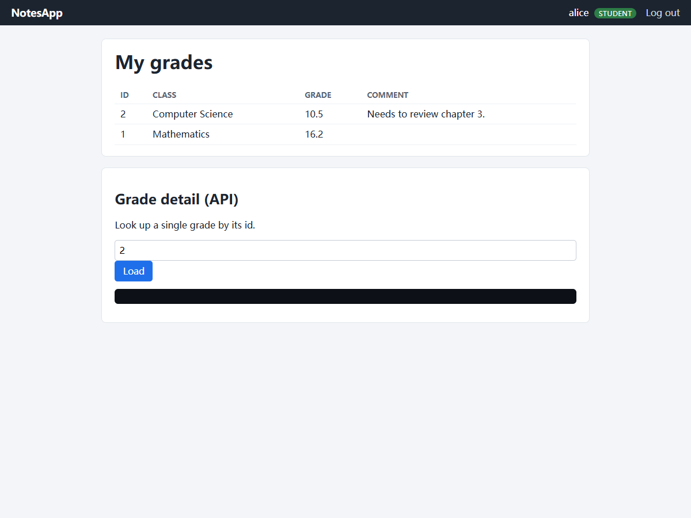

# Class 10 — Stored XSS: a comment that runs in someone else's browser

**App:** local NotesApp clone, HTTP on `127.0.0.1:8080`
**Author:** Chen Ziming (CHU 2023905333) — individual execution
**Date:** 2026-11-18
**Fix commit:** `845e4be`

Class 9 was injection on the way **in** — what you type becomes a command. This is
injection on the way **out** — what the server **stores** becomes **code** in another
person's page. One teacher comment is stored once and read by every student; flaw #10
made the browser run it. The fix is not a blacklist of dangerous words: it is putting
the escaping back, so a comment stays data.

## Finding (hand-in)

[`audit.txt`](audit.txt) — summary: the stored
`<script>alert('XSS by Eve')</script>` **ran** in alice's dashboard in a real browser
(dialog “XSS by Eve”, Chrome 157.0.8103.79); after removing ``
in **both** templates, the same database value is displayed as `&lt;script&gt;…` and
never runs; a normal comment containing `<` and `&` still reads correctly.

## Part 1 — plant a script in a comment and watch it fire

Note 1 is **alice's** Mathematics grade (user id 6, grade 16.2). Logged in as
`prof.turing` (teacher), the comment went in through the normal `/grades` form:

```bash
curl -s -c teacher.jar -d "username=prof.turing&password=teach123" \
     http://127.0.0.1:8080/login -o /dev/null -w "teacher login: HTTP %{http_code}\n"
curl -s -b teacher.jar \
     --data-urlencode "note_id=1" --data-urlencode "grade=16.2" \
     --data-urlencode "comment=<script>alert('XSS by Eve')</script>" \
     http://127.0.0.1:8080/grades -o /dev/null -w "comment saved: HTTP %{http_code}\n"
```

Prediction, written before running ([`prediction.md`](prediction.md)): **it runs**.
The page alice receives carries the cell verbatim — 1 raw `<script>` match, 0 escaped
([transcript](evidence/before/part1_curl_transcript.txt),
[raw page](evidence/before/part1_alice_dashboard_raw.html)):

```html
<td><script>alert('XSS by Eve')</script></td>
```

The teacher's own `/teacher` page has the same line and the same raw tag, so the
second template was carrying the flaw too.

`curl` shows the HTML but never executes it, so the difference between “shown” and
“run” was observed in a real engine ([`verify_browser.js`](verify_browser.js), headless
Chrome):

| Observation | alice `/dashboard` | teacher `/teacher` |
| --- | --- | --- |
| `alert` dialog | **fired — “XSS by Eve”** | **fired — “XSS by Eve”** |
| script element inside the comment cell | yes | yes |
| characters displayed in the cell | none | none |



The empty COMMENT cell in that screenshot is the point: those bytes were not shown as
text, they became an element that ran. A native `alert` is browser chrome, not page
content, so it cannot appear in a page screenshot — the dialog event recorded by the
browser is the proof ([browser-before.json](evidence/before/browser-before.json)).

## Part 2 — put the glass back

Both `web/templates/dashboard.html` (line 15) and `web/templates/teacher.html`
(line 49) had:

```jinja
<td>{{ n.comment }}</td>
```

Both became:

```jinja
<td>{{ n.comment }}</td>
```

Jinja2 escapes by default; the wrapper switched that safety **off** for exactly one
expression. Nothing else changed. Templates are `COPY`ed into the image, so a rebuild
is required — `docker compose -f docker-compose.yml -f compose.windows.yml up -d
--build` — after which `grep -rn 'autoescape false' /app/templates/` exits 1.

Without touching the stored row, alice's dashboard now contains 0 raw `<script>` and
1 escaped copy ([transcript](evidence/after/part2_escaped_transcript.txt)):

```html
<td>&lt;script&gt;alert(&#39;XSS by Eve&#39;)&lt;/script&gt;</td>
```

## Part 3 — prove the same attack is dead

Re-sent the identical payload as the teacher, then fetched alice's dashboard:
`<script>alert` → not found, `&lt;script&gt;…` → present
([transcript](evidence/after/part3_resaved_transcript.txt)). In the browser the page
raises no dialog and shows the characters
([browser-after.json](evidence/after/browser-after.json),
[dashboard-after.png](evidence/after/dashboard-after.png)).

The stored value never changed between Part 1 and Part 2 — only the render did. That
is why the fix also cleans up old rows: the teacher does not need to re-post anything.

## Part 4 — real comments still display correctly

Posted `score < 10 on part 1 & 2, see me` (grade 11.0) through the same form. The page
carries `score &lt; 10 on part 1 &amp; 2, see me` and no raw `score < 10`
([transcript](evidence/after/part4_normal_comment_transcript.txt)); Chrome renders it
exactly as written ([dashboard-normal.png](evidence/after/dashboard-normal.png)).

## Why escaping, not filtering

A filter has to guess every dangerous spelling (`<script>`, ``,
`<svg onload>`, event handlers, `javascript:` URLs…). Escaping has nothing to guess:
`<` becomes `&lt;`, so the parser can never leave text mode. The browser then
**displays** every character of the comment and **runs** none of it. If rich text is
ever really needed (bold, links), the answer is still not `autoescape false` — it is
server-side sanitising with an allow-list (e.g. `bleach`) so only a known-safe subset
of tags survives.

## Scope and honesty

- **Measured:** the alert fired in alice's authenticated dashboard and in the teacher
  table; the raw tag was present before and absent after; the escaped text is what a
  browser displays; a normal comment still renders; the app still logs in and serves
  grades normally.
- **Source-derived:** the cause is the `autoescape false` wrapper in two templates;
  `base.html` has no CSP/nonce, and `app.py` sets no `Content-Security-Policy`, so a
  policy would not have stopped the inline script either. Flask's session cookie
  defaults to `HttpOnly` and the app does not override it, so `document.cookie` is
  unlikely to hand over the session.
- **Not attempted:** cookie theft, silent `POST /grades` as alice, or reading another
  student's grade from her browser. Those follow from “the script runs in alice's
  origin with her session”, which *is* measured; the concrete action is not. A script
  does not need the cookie for that — a same-origin `fetch` carries her session
  automatically.
- `/api/notes/<id>` still returns the comment as JSON. That is correct, and the
  dashboard's own JS writes it with `textContent`; a future client that assigns it to
  `innerHTML` would reintroduce the same flaw on a different path. Not exploited here.
- Only flaw #10 was changed. The app's other teaching flaws (e.g. #11 missing CSRF on
  the grade POST, #13 container runs as root with the Docker socket mounted) remain.

## Tests

`pytest` → **106 passed** (4 new), coverage unchanged from Class 9 —
`web/app.py` 84 %, the four security modules 100 %, total 88 %
([pytest.txt](evidence/after/pytest.txt)).

- `tests/test_stored_xss.py` (new): the student dashboard and the teacher table both
  deliver the payload as escaped text and never as a live `<script>`; a normal
  comment keeps its `<` and `&`; and a guard test fails if **any** template in the
  Jinja search path contains `autoescape false` again.

## Data integrity

`users/classes/enrollments/notes` = 35 / 4 / 60 / 60, unchanged. All 60 comments are
still `aesgcm:v1:` ciphertext (0 rows without that prefix) — encryption at rest was
never the problem, and escaping does not touch storage. Note 1 still belongs to alice;
it now carries the Part 4 text and grade 11.0
([data_integrity.txt](evidence/after/data_integrity.txt)).

## How these numbers were produced

The lab stack was started with
`docker compose -f docker-compose.yml -f compose.windows.yml up -d --build` and the
fixes verified after a rebuild. The suite was run in a throwaway container with the
repository tree mounted (`TEST_DB_HOST=db`) because this Windows host's temporary
directory was unusable at the time; the tests themselves are the same ones a normal
`python -m pytest -q` runs against `127.0.0.1:15432`.

## Reproduce

```bash
docker compose -f docker-compose.yml -f compose.windows.yml up -d --build
# http://127.0.0.1:8080 ; alice/alicepw, prof.turing/teach123
node verify_browser.js before ./evidence/before     # expect the alert dialog
node verify_browser.js after  ./evidence/after      # expect inert text
node verify_browser.js normal ./evidence/after      # expect "score < 10 ..."
```

`verify_browser.js` needs the `playwright` package and a local Chrome or Edge; it uses
the system browser through `executablePath`, so no Playwright browser download is
required.

The fixed code is commit `845e4be`; the templates are in
[`fix-stored-xss.patch`](fix-stored-xss.patch).
